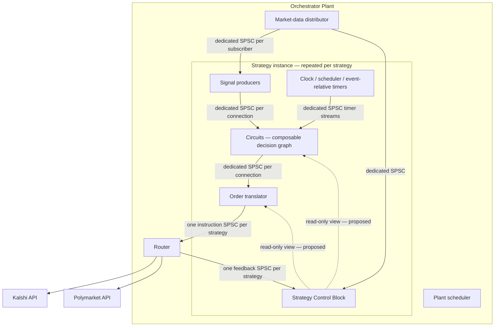

# Initial architecture — draft v0.1

Status: discussion structure captured at the owner's request. Not an approved implementation specification. No product code, stubs, executable tests, or integration is authorized by this document. Exact operation contracts, Hoare triples, adversarial test plans, and owner approval are still required under AGENTS.md.

## 1. Architectural model

The Orchestrator Plant is analogous to an operating system; each Strategy is analogous to a process. These are logical boundaries, not a decision to use operating-system processes or one thread per component.

The Plant contains a set of Strategy instances and a Plant scheduler. Each Strategy is a container with a Strategy Control Block (SCB), modular signal producers, decision circuits, timing facilities, and an order translator. A Router consumes generic order instructions and translates them into Kalshi or Polymarket operations.

Arrows label logical streams, not threads. SCB event-update ownership, internal handoff details, and Router exchange-I/O topology remain to be specified. No diagram edge permits multiple producers or consumers on one SPSC buffer.

## 2. Component responsibilities

| ID | Component | Responsibility |
|---|---|---|
| ARC-PLANT | Orchestrator Plant | Holds Strategy instances and a scheduler; manages their lifecycle and shared infrastructure. |
| ARC-DIST | Market-data distributor | Fans data out through a separate SPSC buffer for every subscriber. |
| ARC-SIGNAL | Signal producer | Independently produces signals through dedicated SPSC connections; supports easy addition and connection. |
| ARC-STRATEGY | Strategy container | Contains its decision graph, timing facilities, order translator, and SCB. |
| ARC-CIRCUIT | Circuit | Consumes a declared set of signals and publishes an aggregate output signal; outputs may feed other circuits. |
| ARC-TIME | Clock and timing services | Support periodic/scheduled evaluation, immediate event triggers, and timers armed/reset/canceled by events. |
| ARC-SCB | Strategy Control Block | Tracks available data/resources and current trade, order, and portfolio state for its Strategy. |
| ARC-TRANSLATOR | Order translator | Converts circuit outputs, considering Strategy state, into generic order instructions published to Router. |
| ARC-ROUTER | Router | Consumes/parses Strategy instructions, routes to the proper exchange, translates to exchange-specific API calls/instructions, and returns execution feedback. |
| ARC-ADAPTER | Exchange translation modules | Encapsulate venue-specific translation within Router; detailed decomposition remains proposed. |

These IDs identify design areas; they are not complete behavioral contract IDs.

## 3. Stream topology

- Every event stream has its own single-producer/single-consumer buffer. There is no unified MPMC queue.
- Each fan-out subscriber gets its own buffer. A single SPSC buffer cannot be shared among consumers.
- Multiple signals entering a circuit use separate input buffers. Multiple circuits entering a translator likewise use separate buffers.
- Each Strategy has a dedicated instruction buffer to Router and a dedicated feedback buffer from Router.
- Multiple Router input buffers do not imply a global order across strategies.
- Publication, exchange acknowledgment, and execution are distinct events; publishing an instruction does not establish a fill.
- Router translates instructions and manages exchange interaction; it does not independently decide trading policy.

Still unspecified: capacities, event schemas, sequencing, ownership/lifetime of payloads, overflow/backpressure, cross-stream consumption order, cancellation races, delivery/replay guarantees, and routing-feedback demultiplexing.

## 4. Modular signals and circuits

Signals are independent producers. Circuits consume sets of signals and produce aggregate signals with a common compositional interface.

Proposed assembly mechanism: a registry and declarative configuration identify component instances, parameters, schemas, and connections; assembly allocates dedicated buffers. Adding a compatible signal or circuit should require its module, approved contracts/tests, and configuration rather than edits to container or Router infrastructure.

Connectivity does not assign trading meaning. Strategy decision rules must explicitly understand a signal's semantics. Exact schemas, compatibility/versioning rules, lifecycle interfaces, plugin mechanism, and configuration validation are open.

An acyclic signal/circuit graph was proposed, but cycle policy is not yet decided. Execution feedback is a separate path into Strategy state.

## 5. Timing

The timing model supports all of:
- Clock-driven periodic or scheduled work.
- Event-driven evaluation on designated input updates.
- Event-relative timers that may be armed, reset, or canceled by events.
- Combined trigger policies, declared per component.

Proposed clock design: a shared time abstraction supports live time and controlled test/replay time. Monotonic time governs elapsed durations/deadlines; UTC timestamps identify external/audit events.

Still unspecified: clock API, timer ownership and buffer topology, precision, lateness policy, missed periods, coincident-event ordering, stale expirations after cancellation/reset, and reproducible replay ordering.

Plant scheduling semantics are explicitly deferred: cooperative bounded work cycles versus independently executing strategies under supervision has not been selected. The relationship between Plant scheduling and Strategy-local scheduling remains open.

## 6. State and resource ownership

Established: every Strategy owns its SCB, tracking current data/resources available and existing trade/portfolio state.

Proposed SCB contents:
- Market observations, signal/circuit outputs, timestamps, freshness, and validity.
- Allocated/available/reserved capital and exposure.
- Pending instructions, working orders, partial fills, completed trades, positions, and balances.
- Health, connectivity, mode, and reconciliation status.

Proposed mutation model: one state-update owner per Strategy consumes events and updates the SCB; decision components receive read-only coherent views. Exact snapshot consistency and update ordering require contracts.

Proposed Plant responsibilities: account-wide balances, resource allocation/reservation across strategies, account-wide reconciliation, lifecycle supervision, and shared infrastructure. SCBs hold strategy-attributed views; they cannot independently claim the same account resources. Allocation protocol and authoritative account-state owner are not yet settled.

Exchanges are authoritative for external execution facts. Local state must distinguish confirmed, stale, and uncertain information. A ledger/persistence mechanism may support SCB updates; durability, recovery, and reconciliation contracts remain open.

## 7. Candidate system invariants for contract refinement

| ID | Candidate invariant |
|---|---|
| INV-001 | Each buffer has exactly one designated producer and consumer; fan-out uses distinct buffers. |
| INV-002 | An order instruction traces to its originating Strategy and decision inputs. |
| INV-003 | Publication or acknowledgment never counts as a confirmed fill. |
| INV-004 | Router does not silently change trading intent, increase authorization, or substitute contracts. |
| INV-005 | Venue identity and resolution semantics survive normalization and routing. |
| INV-006 | Unknown execution status remains explicit until reconciliation resolves it. |
| INV-007 | Retries must not create unintended duplicate exposure. |
| INV-008 | Strategies must not collectively allocate/use more shared resources than authorized. |
| INV-009 | Decisions retain sufficient input/state/time provenance for reconstruction. |
| INV-010 | Paper and live execution modes remain explicit and separated. |

These are proposed guarantees, not proven properties or approved operational contracts. Definitions of authorization, resources, confirmation, timing, and recovery must become exact.

## 8. Next specification work — before implementation

1. Resolve deferred architecture decisions, especially scheduling, SCB update ownership, Plant resource coordination, graph topology, and Router lifecycle.
2. Define message schemas, stream contracts, state machines, and operation-level Hoare triples with stable contract IDs.
3. Define test cases and traceability for every contract/invariant, including fuzzing, fault injection, and bounded campaign budgets.
4. Obtain explicit approval of the complete architecture and component specifications at an identified revision.
5. Write executable contract/adversarial tests before any production code, scaffolding, or stubs.

Failure modes are tracked in [FAILURE_MODES.md](FAILURE_MODES.md); this draft adds FM-005 through FM-010. The recording change is CHG-0002 in [CHANGELOG.md](../CHANGELOG.md).
